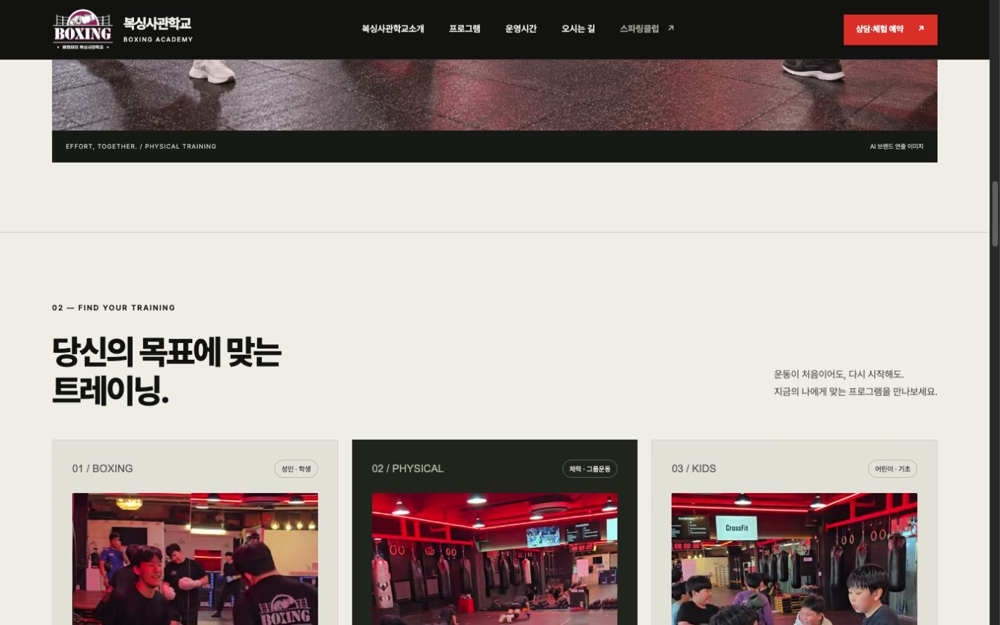
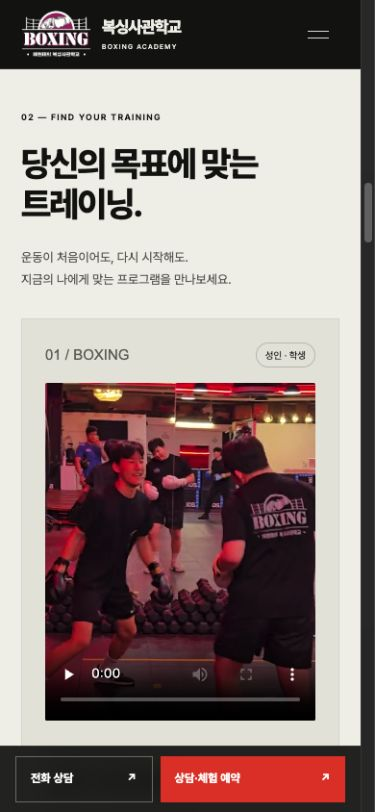
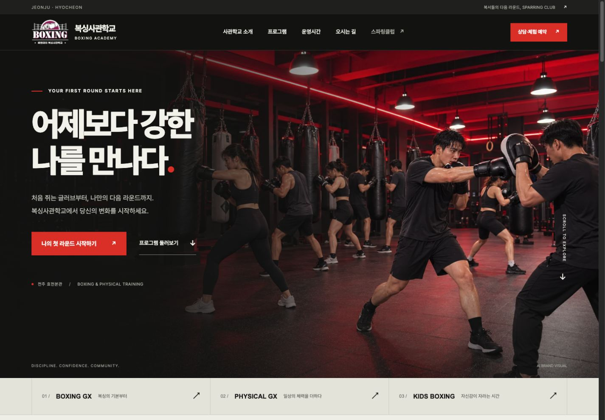
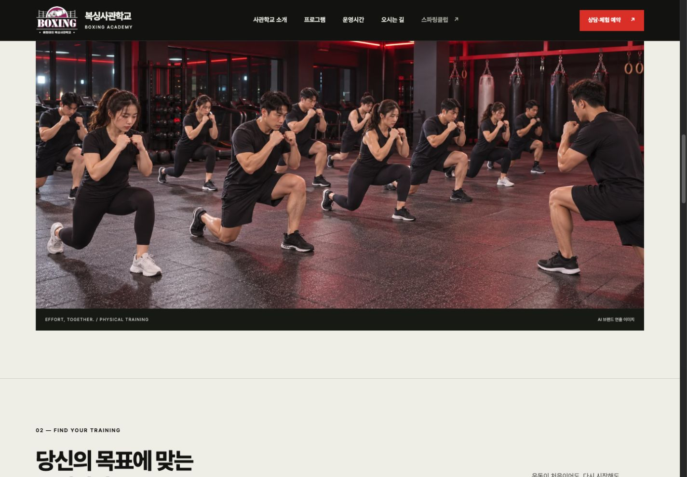
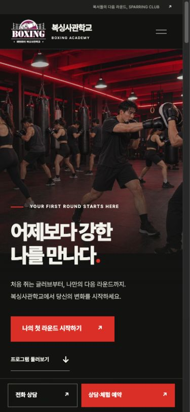
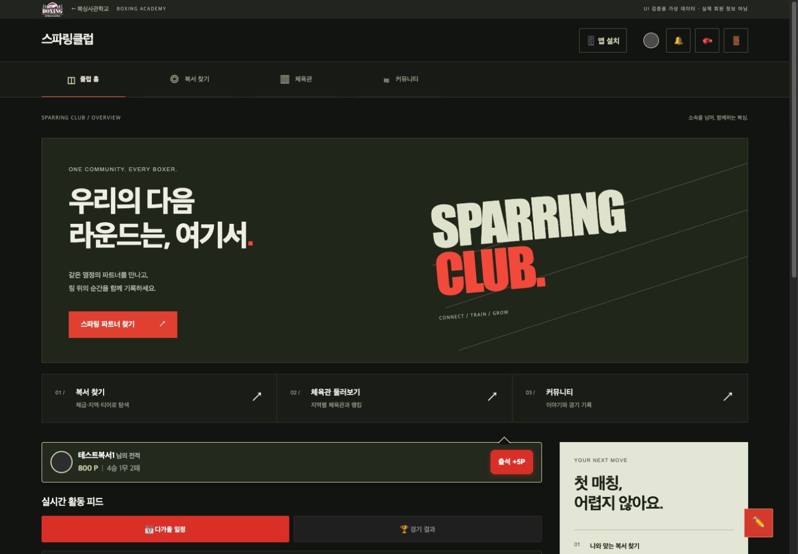
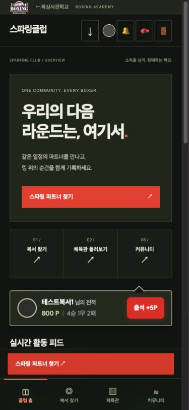
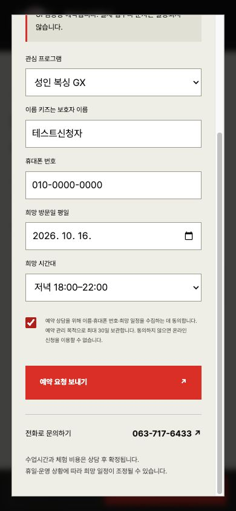
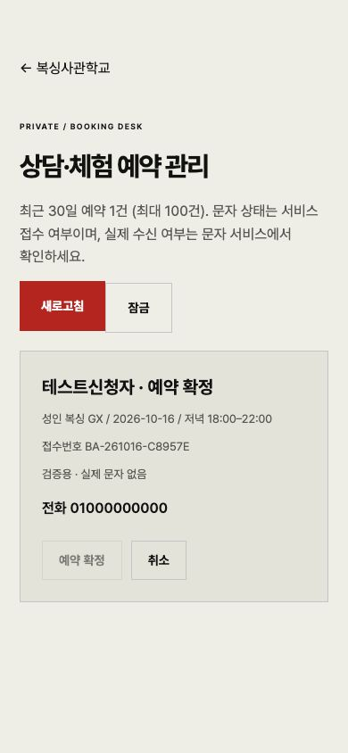

# UI 재구성 검증 결과

## 2026-10-16 신규 방문자용 에디토리얼 UI

- 새 첫 화면에 공식 로고, 초보자와 코치의 콘셉트 장면, 동일한 `상담예약` 행동을 사용했습니다. 프로그램에는 기존 실제 수업 영상·사진을 배치하고, 심박 측정과 Record 운동기록은 수강 프로그램과 분리했습니다.
- 1440px 데스크톱, 768px 태블릿, 390px 모바일을 실제 브라우저에서 확인했습니다. 네 장의 [UI 화면 이미지](mockups/)는 데스크톱 전체 페이지, 모바일 첫 화면, 프로그램 탐색, 상담예약 입력입니다.
- 모바일은 본문과 하단 버튼을 별도 화면 영역에 배치하여 버튼이 내용·입력창을 가리지 않습니다. 빈 항목은 항목 아래에서 안내합니다. 브라우저의 검증용 예약 서버에서 입력 → D1과 같은 SQLite 쿼리 저장 → 접수번호 표시까지 확인했습니다. 실제 문자 발송은 하지 않았습니다.
- `npm test` 16개 통과, `npm run build` 성공. 디자인 소스 검사 0건 위반; 렌더 검사에서 2줄 초과 제목·가로 넘침·본문 가림을 수정했습니다. 실제 운영 배포와 휴대폰 SMS 수신은 아직 확인되지 않았습니다.

## 2026-10-16 수업 콘텐츠 추가 검증

- 상단 메뉴를 `복싱사관학교소개`로, 성인 수업을 `성인·학생복싱`으로 변경하고 예약 선택값도 연결했습니다. 기존 `성인 복싱 GX` 예약값은 서버에서 계속 허용합니다.
- 성인·학생복싱, 피지컬 트레이닝, 키즈복싱 카드에 실제 수업 영상과 수업 흐름·기대 목표를 추가했습니다. 세 수업을 담은 33초 광고영상과 공식 로고 마무리 화면도 연결했습니다.
- 1440px PC에서 세 카드가 정렬되고, 390px 및 320px 모바일에서 단일 열과 하단 상담 버튼이 유지되며 가로 넘침이 없음을 Chromium 미리보기에서 확인했습니다.
- `npm test` 15개 통과, `npm run build` 성공. 영상은 `ffprobe`에서 H.264 영상과 AAC 오디오로 확인했습니다. 실기기 및 운영 배포 환경의 영상 재생은 별도 확인이 필요합니다.

검증일: 2026-10-15. Codex의 Chromium 기반 브라우저에서 실제 렌더링과 상호작용을 확인했습니다.

## 화면 크기

| 화면 폭 | 공식 홈페이지 | 스파링클럽 4개 화면 | 기기별 구성 |
| --- | --- | --- | --- |
| 320px | 통과 | 통과 | 단일 열, 터치 필터, 하단 CTA/메뉴 |
| 390px | 통과 | 통과 | 단일 열, 모바일 메뉴와 하단 CTA |
| 600px | 통과 | 통과 | 넓은 모바일 구성과 터치 탐색 |
| 768px | 통과 | 통과 | 태블릿 그리드와 상단 내비게이션 |
| 1024px | 통과 | 통과 | 넓어진 콘텐츠와 적응형 그리드 |
| 1440px | 통과 | 통과 | 데스크톱 그리드, 피드·사이드 안내 |
| 1920px | 통과 | 통과 | 와이드 히어로, 넓은 콘텐츠 영역 |
| 2560px | 통과 | 통과 | 콘텐츠 최대 폭과 중앙 정렬 유지 |

스파링클럽은 홈·복서·체육관·커뮤니티를 각 크기에서 확인했습니다. 초기 320px 체육관 필터의 가로 넘침을 수정하고 재검증했습니다. 최종 32개 화면 검사에서 문서 가로 넘침이 없었습니다. 측정값은 [공식 홈페이지](academy-layout-checks.json), [스파링클럽](club-layout-checks.json)에 남겼습니다.

## 동작

- 공식 홈페이지: 모바일 메뉴 열기·닫기, 메뉴에서 섹션 이동, 상담 대화상자, 관심 프로그램 선택, 평일/주말 운영시간 전환.
- 전화 링크는 모두 사용자 지정 `063-717-6433`으로 연결. 플레이스·지도·실제 시설 사진으로 연결되는 주소 확인.
- 스파링클럽: 주요 4개 탭 이동, 지역 필터(8명 → 전북 4명), 로그인 창, Esc 닫기.
- 회원 상태: 매칭 신청 폼 열기, 커뮤니티 글쓰기·취소, 체육관 프로필 열기·닫기.
- 관리자 상태: 기존 관리 화면 진입과 320px 헤더·메뉴 배치 확인.
- 브라우저 확대를 막던 기존 터치 이벤트와 viewport 제한을 제거. 키보드 초점, 대화상자 이름·초점 제한, 감소된 모션 설정을 지원.

## 자동 검사

`npm test`: 15개 검사 통과. `npm run build`: 성공.

- 원본 커밋 `23418a4`의 Firebase 설정 및 업무 스크립트 보존 비교. 차이는 화면 전환 알림과 확대 차단 해제뿐입니다.
- 기존 페이지·DOM 연결점 보존 및 JavaScript 문법 확인.
- 기존 루트 탭/게시글 공유 링크와 설치형 앱 진입 경로 확인.
- 공식 전화번호 일치 검사.
- PWA 캐시 대상 파일 존재, 푸시 수신·클릭 이벤트 보존 검사.
- 페이지별 오프라인 문서 선택 및 API·Firebase·POST 캐시 제외 검사. Pages의 `/club` 주소도 처리.

## 실제 검증 범위

스파링클럽 상호작용은 가상 데이터와 서버 쓰기 차단 기능을 갖춘 로컬 QA 서버로 검증했습니다. 실제 회원 계정의 로그인, 매칭 전송, 게시물 등록, 파일 업로드, 결제 또는 운영 데이터 변경을 실행하지 않았습니다. 이 검증은 기존 서버 권한 규칙이나 실제 인증·업로드·푸시 전달의 성공을 보증하지 않습니다.

실기기 Safari/Android, Lighthouse 점수 및 실제 Cloudflare 배포는 미검증입니다. Cloudflare 연결이 로그인되지 않아 배포 URL을 발급하지 않았습니다. DNS·네임서버·`CNAME`은 변경하지 않았습니다.

## 공식 로고 반영

사용자 제공 로고 원본을 상단·하단·방문 안내·스파링클럽 학교 링크·브라우저 아이콘에 적용했습니다. 임시 BA 그림을 제거했습니다. OneDrive 성인 영상의 붉은 체육관 분위기를 참고해, 여러 성인이 샌드백·미트·체력운동에 집중하는 두 AI 브랜드 이미지를 만들고 PC·모바일에 적용했습니다. 실제 캡처는 검토용으로만 남겼습니다. 생성 이미지에는 AI 표시가 있습니다.

## 자체 예약 · 유료 SMS 준비

- 모바일 예약 입력 → 서버 입력 검증 → 메모리 SQLite에 실제 SQL로 저장 → 접수번호 표시 → 관리자 인증·조회·확정까지 브라우저에서 확인했습니다. QA의 모든 문자는 대체 처리되어 실제 SMS나 비용이 발생하지 않습니다.
- 8개 화면 폭에서 예약 대화상자가 화면 안에 들어오고 가로 넘침이 없는 것을 확인했습니다. [예약 측정값](booking-layout-checks.json).
- 원격 API가 없는 정적 서버에서는 신청 버튼이 비활성화되고 전화 문의 안내가 표시되는 것을 확인했습니다.
- API 자동 검사: 설정 미비, 잘못된 입력·출처, 중복 요청, 변경된 중복 요청, 남용 제한, 저장 오류, 문자 오류 시 예약 보존, SOLAPI 서명·응답 처리, 관리자 인증·상태 변경, 보관기간 정리.
- API 테스트는 운영 마이그레이션을 메모리 SQLite에서 실행합니다. Cloudflare의 실제 D1/Functions 환경 배포 검증과 SMS 휴대폰 수신은 설정 후 별도로 필요합니다. SMS 실제 발송은 실행하지 않았습니다.
- 320px에서 게스트·회원·체육관장·관리자 상단 구성을 확인했습니다. 설치 버튼을 축약 아이콘으로 고쳐 회원 알림 버튼과 겹치지 않도록 했습니다.

## 화면

공식 홈페이지 PC:

단체 체력운동 소개:

공식 홈페이지 모바일:

스파링클럽 PC (UI 검증용 가상 데이터):

스파링클럽 모바일 (UI 검증용 가상 데이터):

예약 입력 (검증용):

예약 관리 (검증용):

